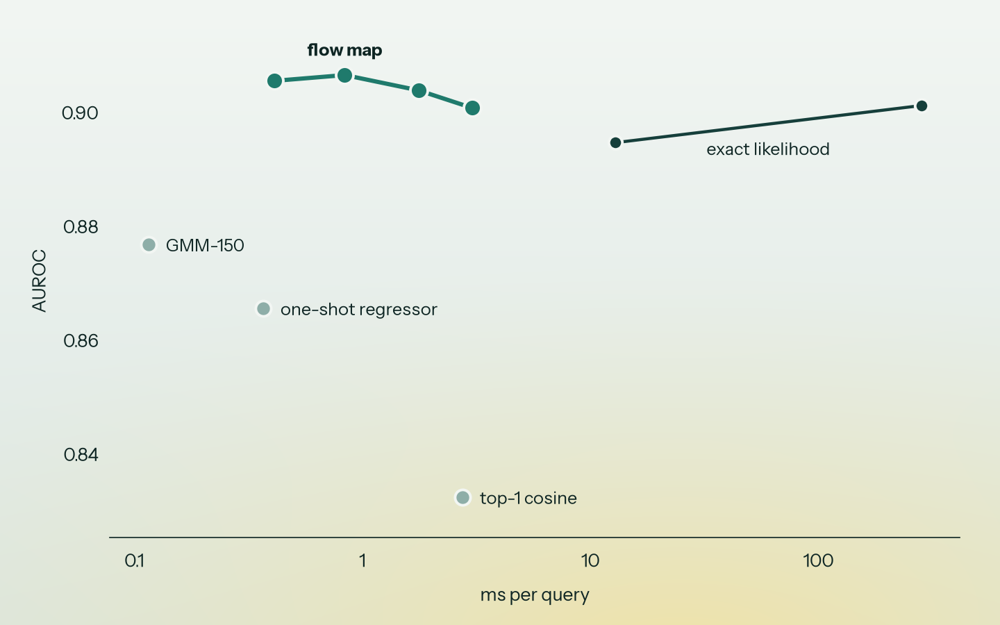

# flowgate

**A fast, label-free "should I act on this?" gate for assistants.**

An assistant can get asked relevant questions ("set a timer"), but also some that are less so ("turn evil"). Before acting, it needs a quick check: *is this for me?* flowgate learns how to do this, trained with in-scope questions only, then makes the check fast enough to run on-device.

<picture>
  <source media="(prefers-color-scheme: dark)" srcset="results/frontier-dark.png">
  
</picture>

## Method

The gate learns what in-scope questions look like and flags questions that don't fit. It is trained without any out-of-scope questions.

```
"set a timer for 10 min"
        │
   1. Encoder (ModernBERT)   turns the question into a vector
        │
   2. Gate (flowgate)        scores the vector: is this for me?
        │
   3. Assistant              yes: does the job
                             no: says it can't help, or passes it on
```

flowgate has two parts: a teacher (flow model) and a student (flow map). The teacher learns the shape of the in-scope data. Its score is accurate but slow: thousands of network calls per question. The student is a second network, trained on the teacher's paths to give the same score in one or two calls.

1. **Embed.** Each question becomes a vector: frozen ModernBERT-base, mean-pooled. These are projected to 128 PCA directions and whitened, so a Gaussian fitted to the in-scope questions has distribution N(0, I)
2. **Learn the shape of the in-scope cloud.** A flow-matching model learns the density of in-scope questions, without using labels
3. **Score.** score(z) = log p_flow(z) − log N(z; 0, I): how much more typical a question looks under the learned shape than under one plain Gaussian. High score -> assistant should act
4. **Flow map jumping.** The exact log-density integrates an ODE with an exact Jacobian trace, which is about 4,000 network calls per query. I record the teacher's ODE paths once, and then train a **flow map**: the same network learns to jump 1, ½, ¼ … of the way along a path, predicting both where the point lands and how its log-density changes. Scoring then takes 1–2 network calls, with no Jacobians

## Results (CLINC150 test set, scored once)

| Method | Test AUROC | ms per query |
|---|---|---|
| Top-1 cosine (the usual RAG threshold) | 0.832 | 2.74 |
| GMM-150 ratio (strongest label-free baseline) | 0.876 | 0.12 |
| Flow teacher, exact likelihood (32 ODE steps) | 0.901 | 283 |
| **Flow-map student, 2 jumps** | **0.906** | **0.84** |

The flow map keeps the teacher's accuracy while being **over 300 times faster**. The teacher already beats every label-free baseline I tested, but at 283 ms per question it is too slow to run before every request. The flow map brings this down to **under a millisecond** on a single CPU thread, making it more practical to use.

## Validation findings

- With 4 ODE steps, the teacher already scored the same as with 32, so most of its cost goes on steps that don't change the result
- I also tried training the flow map on extra synthetic points away from the in-scope data. However, I found that training on in-scope paths alone was just as good, possibly because real out-of-scope questions sit quite close to the in-scope data.
- The teacher is stable across training seeds: three runs with different seeds scored between 0.894 and 0.897.

## Limits

- I used one dataset (CLINC150) and encoder, and seeds were checked on just the validation split
- The model size (128 dimensions, width 512) was chosen on a validation split that includes some labelled out-of-scope questions, but training never sees out-of-scope data
- The timings are for the gate alone, on precomputed embeddings, so they don't include the ModernBERT encoder. They were measured on a single CPU thread on a laptop

## Reproduce

Requires [uv](https://docs.astral.sh/uv/). Runs on CPU. Data goes to `$FLOWGATE_DATA_DIR` (default `~/kwa-data`).

```bash
uv sync
uv run flowgate embed                 # download CLINC150 + ModernBERT-base, cache embeddings
uv run flowgate r1                    # train the flow teacher (~20 min), score the validation split
uv run flowgate r2 --starts train     # record teacher paths (~1 h, once), distil the student (~10 min)
uv run flowgate time                  # one interleaved timing pass for every method
uv run flowgate report                # accuracy-vs-cost table
uv run python scripts/make_results.py # regenerate results/ (never edited by hand)
uv run pytest                         # 55 tests
```

The test split is refused unless `--final` is passed; it was used once, exactly as listed in TEST_PLAN.md.

## Code map

| File | What it does |
|---|---|
| `data.py` | CLINC150 → ModernBERT embeddings, cached |
| `space.py` | PCA + whitening, so the background Gaussian is N(0, I) |
| `net.py` | One network: a flow map Φ(x, t, s) with a log-density head |
| `train.py` | Conditional flow matching (the teacher) |
| `likelihood.py` | Exact-trace ODE log-density; recording whole paths |
| `gate.py` | The gate: fit on in-scope data, score anything |
| `distill.py` | The flow-map student, trained on recorded paths |
| `stats.py` | AUROC and paired bootstrap confidence intervals |
| `gmm.py`, `latency.py` | GMM baseline scorer; the timing protocol |
| `cli.py` | The commands above |
